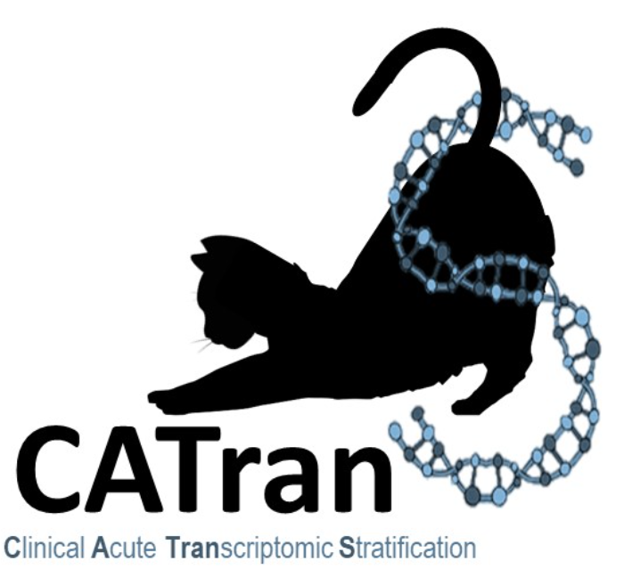

# CATranS: Clinical Acute Transcriptomic Stratification

  

**CATranS** is a bioinformatics and machine learning routine written in Python designed to expand classification of samples based on a clinical acute initial labeling using transcriptomic count data. 

Through an iterative, semi-supervised learning approach, CATranS combines data normalization, batch correction, correlation-based feature selection, and class prediction to refine classifications of patient cohorts.

---

## Key Features

- **Iterative Semi-Supervised Relabeling**: Safely expands training cohorts by predicting clinical labels on unclassified/unlabeled samples using high-confidence thresholds.
- **Generalized Custom Classes**: Supports user-defined positive and negative class labeling (e.g., `Survivor`/`NonSurvivor`, `Mild`/`Severe`, `Responders`/`NonResponders`) with robust Categorical ordering to fix contrast directions in DESeq2.
- **Batch Correction**: Integrated with `inmoose` for ComBat-seq count batch effect correction.
- **DESeq2-style Normalization**: Leverages the high-performance `pydeseq2` implementation for median-of-ratios normalization.
- **Correlation-Based Feature Learning**: Custom graph-theory based gene selection utilizing `igraph`. Filters out highly redundant co-expressed genes and selects optimal representative biomarkers correlating with clinical outcomes.
- **Flexible Estimator Integration**: Compatible with any Scikit-Learn classifier exposing a `predict_proba` method.

---

## Installation

We recommend using [uv](https://github.com/astral-sh/uv) or `pip` for rapid virtual environment setup and dependency management.

```bash
# Install from PyPI with pip (Not available atm)
pip install catrans 
# Install from PyPI with uv (Not available atm)
uv add catrans
# Install directly from GitHub
pip install git+https://github.com/gsrm/CATranS.git
```

### Dependencies
- Python `>=3.11`
- `numpy>=2.3.0`
- `pandas>=2.3.3`
- `scipy>=1.17.1`
- `scikit-learn>=1.8.0`
- `pydeseq2>=0.5.4`
- `igraph>=1.0.0`
- `inmoose>=0.9.1`

---

## API Reference & Usage Scenarios

### Core Classes & Functions

#### 1. `CatransClasses` Object
Defines the names of the binary classes.  
- `positive` (default `"Positive"`): The target/case class.  
- `negative` (default `"Negative"`): The reference/control class.  

#### 2. `correlation_based_feature_selection`
Identifies representative biomarker genes by correlating expression levels with labels, building a gene-gene correlation network, and selecting one representative gene per connected component.  
- `data` (pd.DataFrame): Gene-expression matrix (genes x samples).  
- `acute_classification` (pd.DataFrame): DataFrame with columns ['sample', 'class'] representing the class label for each sample.  
- `classes` (CatransClasses, Optional): CatransClasses object defining positive and negative labels.  
- `pval` (float, default `0.05`): P-value threshold for significance when filtering gene-gene correlations.  
- `cutoff_corr` (float, Optional): Minimum absolute Spearman Rho for including genes in the gene-gene graph. If not passed, this cuttoff will be determined by the Q3 of Spearman Rho absolute values.  
- `cutoff_corr_genes` (float): Minimum absolute Pearson R for edge inclusion in the graph. If not passed, this cuttoff will be determined by the Q3 of Pearson R absolute values. Bonferroni correction is performed on Gene x Gene correlation results.  

#### 3. `run_catrans`
Runs the iterative semi-supervised relabeling pipeline.  
- `raw_counts` (pd.DataFrame): Genes (rows) by Samples (columns).  
- `metadata` (pd.DataFrame): Samples (rows) with metadata.  
- `acute_classification` (pd.DataFrame): Samples (rows) with initially known labels under the column `"class"` (unlabeled samples should be `NaN`).  
- `model`: Any Scikit-Learn compatible classifier (e.g. `RandomForestClassifier`, `SVC(probability=True)`).  
- `classes` (CatransClasses, Optional): Custom positive/negative class names.  
- `batch_col` (str, Optional): Metadata column to use for ComBat-seq batch correction.  
- `model_threshold` (float, default `0.8`): Confidence threshold to assign a label.  
- `signature_genes` (list[str], Optional): Genes to use for training the model. If `None`, `correlation_based_feature_selection` runs automatically with default parameters.  

#### 4. `CatransResult` Object
The result of `run_catrans` function is a `CatransResult` object, containing the following attributes:  
- `number_of_iterations`: Number of iterations needed for the algorithm to converge.  
- `iterations`: List of the iteration results of each cycle the algorithm performed. Each component of the list is a `_IterationResult` object.  
- `last_iteration`: Equivalent of `CatransResult.iterations[-1]`. The last `_IterationResult` of the algorithm, containing different results:  
    - `iteration`: Iteration index.  
    - `differentially_expressed_genes`: Number of DEGs on this iteration.  
    - `differential_expression_analysis_results`: DEA results for this iteration in DataFrame format.
    - `model_classification`: Classification results for this iteration in DataFrame format.

---

### Usage Scenarios

#### **Scenario 1**: Normal Workflow (Two-step Feature Selection + Stratification)
This is the recommended workflow where you first find a non-redundant gene signature, then pass it to the CATranS pipeline.

```python
import numpy as np
import pandas as pd
import statistics
from sklearn.ensemble import RandomForestClassifier
import catrans

# 1. Load your transcriptomics and clinical datasets
counts = pd.read_csv("data/raw_counts.tsv", sep="\t", index_col=0)
metadata = pd.read_csv("data/metadata.tsv", sep="\t", index_col=0)

# 2. Define an Acute classification
## For this example, this classification is based on clinical data only, catching the extreme cases of the condition.

is_survivor = metadata["vital_status"] == "Survivor"
is_non_survivor = metadata["vital_status"] == "NonSurvivor"

### We use Q3 of 'days_to_last_follow_up' as threshold for Survivors
threshold_survivor = metadata.loc[is_survivor, "days_to_last_follow_up"].quantile(0.75)
is_acute_survivor = (metadata['days_to_last_follow_up'] > threshold_survivor) & is_survivor
## We use Q1 of "days_to_last_follow_up" as threshold for Non-Survivors
threshold_non_survivor = metadata.loc[is_non_survivor, "days_to_last_follow_up"].quantile(0.25)
is_acute_non_survivor = (metadata['days_to_last_follow_up'] < threshold_non_survivor) & is_non_survivor

acute_indices = metadata[is_acute_survivor | is_acute_non_survivor].index
acute_classification = pd.DataFrame({
    'sample' : acute_indices,
    'class'  : np.where(is_alive.loc[acute_indices], "Survivor", "NonSurvivor")
}).set_index('sample', drop=False)
acute_classification.index.name = None

## save classification to file
acute_classification = acute_classification.to_csv("data/acute_classification.tsv", sep="\t", index=True, header=True)

# Define custom labels: "Survivor" (negative) and "NonSurvivor" (positive)
my_classes = catrans.CatransClasses(positive="NonSurvivor", negative="Survivor")

# 3. Perform correlation-based feature selection to identify candidate biomarkers
signature = catrans.correlation_based_feature_selection(
    data=counts,
    acute_classification=acute_classification,
    classes=my_classes,
    pval=0.05,
    cutoff_corr=0.5,
    cutoff_corr_genes=0.8
)

# 4. Run the semi-supervised relabeling pipeline using the selected signature
results = catrans.run_catrans(
    raw_counts=counts,
    metadata=metadata,
    acute_classification=acute_classification,
    classes=my_classes,
    model=RandomForestClassifier(random_state=42),
    model_threshold=0.75,
    signature_genes=signature,
    n_cpus=4
)
```

```python
## Exploring the results
print(results.final_classification)
```
|              | class       |
|:-------------|:------------|
| Sample_1 | nan         
| Sample_2 | Survivor    
| Sample_3 | NonSurvivor 
| Sample_4 | NonSurvivor 
| Sample_5 | nan         
| Sample_6 | nan         
| Sample_7| Survivor    
| ....         | ...         


```python
## If we would want to explore the DEA results we should inspect the `last_iteration` attribute
print(results.last_iteration.differential_expression_analysis_results) # pd.DataFrame
```
|                    |   baseMean |   log2FoldChange |    lfcSE |       stat |     pvalue |       padj |
|:-------------------|-----------:|-----------------:|---------:|-----------:|-----------:|-----------:|
| ENSG00000000003.15 |   4741.28  |       -0.138988  | 0.16687  | -0.83291   | 0.404896   | 0.616775   |
| ENSG00000000419.13 |   3451.85  |       -0.0107627 | 0.140807 | -0.0764359 | 0.939072   | 0.97293    |
| ENSG00000000457.14 |    729.99  |        0.199053  | 0.126976 |  1.56764   | 0.116964   | 0.286715   |
| ENSG00000000460.17 |    546.356 |        0.250599  | 0.173118 |  1.44756   | 0.147739   | 0.331886   |
| ENSG00000000938.13 |    412.79  |        0.916682  | 0.244193 |  3.75392   | 0.00017409 | 0.00375287 |

```python
## We can also explore the rest of iteration results if needed on the `iterations` list
results.iterations
```


#### **Scenario 2**: Predefined/Custom Gene Signature (Direct Stratification)
If you already have a target gene signature (e.g., from literature or a previous experiment), you can bypass the feature selection step entirely and run the stratification pipeline directly.

```python
import pandas as pd
from sklearn.svm import SVC
import catrans

counts = pd.read_csv("data/raw_counts.tsv", sep="\t", index_col=0)
metadata = pd.read_csv("data/metadata.tsv", sep="\t", index_col=0)
acute_classification = pd.read_csv("data/acute_classification.tsv", sep="\t", index_col=0)

# Custom predefined signature from literature
custom_signature = ["ENSG00000034693.15", "ENSG00000101188.5", "ENSG00000104870.13"]

# Run the CATranS pipeline directly with the custom signature
results = catrans.run_catrans(
    raw_counts=counts,
    metadata=metadata,
    acute_classification=acute_classification,
    model=SVC(probability=True, random_state=42),
    model_threshold=0.8,
    signature_genes=custom_signature,
    n_cpus=4
)
```

#### **Scenario 3**: Implicit Feature Selection (Defaulting Signature Genes)
If you do not specify a list of `signature_genes`, `run_catrans` will automatically execute `correlation_based_feature_selection` under the hood using default parameters.

```python
import pandas as pd
from sklearn.ensemble import RandomForestClassifier
import catrans

counts = pd.read_csv("data/raw_counts.tsv", sep="\t", index_col=0)
metadata = pd.read_csv("data/metadata.tsv", sep="\t", index_col=0)
acute_classification = pd.read_csv("data/acute_classification.tsv", sep="\t", index_col=0)

# Run CATranS (it will automatically perform feature selection internally)
results = catrans.run_catrans(
    raw_counts=counts,
    metadata=metadata,
    acute_classification=acute_classification,
    model=RandomForestClassifier(random_state=42),
    model_threshold=0.75,
    n_cpus=4
)
```

#### **Scenario 4**: Default Thresholds & Core Settings
You can omit optional arguments like `model_threshold` or `classes` if you wish to use the defaults (`model_threshold=0.8`, `classes` defaulting to `"Positive"`/`"Negative"`).

```python
import pandas as pd
from sklearn.ensemble import RandomForestClassifier
import catrans

counts = pd.read_csv("data/raw_counts.tsv", sep="\t", index_col=0)
metadata = pd.read_csv("data/metadata.tsv", sep="\t", index_col=0)
acute_classification = pd.read_csv("data/acute_classification.tsv", sep="\t", index_col=0)

# Minimal parameters
results = catrans.run_catrans(
    raw_counts=counts,
    metadata=metadata,
    acute_classification=acute_classification,
    model=RandomForestClassifier(random_state=42)
)
```

#### Scenario 5: Running with Batch Correction
To normalize and batch-correct raw counts concurrently, specify the name of the batch column in your metadata dataframe:

```python
results = catrans.run_catrans(
    raw_counts=counts,
    metadata=metadata,
    acute_classification=acute_classification,
    model=RandomForestClassifier(random_state=42),
    batch_col="batch"  # ComBat-seq batch effect correction column
)
```

---

## License

This project is licensed under the MIT License - see the [LICENSE](LICENSE) file for details.
