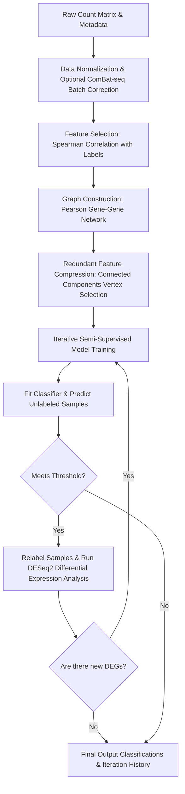

# CATranS: Clinical Acute Transcriptomic Stratification

**CATranS** is a robust bioinformatics and machine learning pipeline written in Python designed to stratify acute clinical cohorts using transcriptomic count data. 

Through an iterative, semi-supervised learning approach, CATranS combines data normalization, batch correction, correlation-based feature selection, and class prediction to refine classifications of patient cohorts (e.g., separating acute from non-acute states or predicting survival outcomes like Alive/Dead).

---

## Key Features

- **Iterative Semi-Supervised Relabeling**: Safely expands training cohorts by predicting clinical labels on unclassified/unlabeled samples using high-confidence thresholds.
- **Batch Correction**: Integrated with `inmoose` for robust ComBat-seq count batch effect correction.
- **DESeq2-style Normalization**: Leverages the high-performance `pydeseq2` implementation for median-of-ratios normalization.
- **Correlation-Based Feature Learning**: Custom graph-theory based gene selection utilizing `igraph`. Filters out highly redundant co-expressed genes and selects optimal representative biomarkers correlating with clinical outcomes.
- **Flexible Estimator Integration**: Compatible with any Scikit-Learn classifier exposing a `predict_proba` method.

---

## Workflow Overview



---

## Installation

We recommend using [uv](https://github.com/astral-sh/uv) or `pip` for rapid virtual environment setup and dependency management.

```bash
# Clone the repository
git clone https://github.com/ruben-canas-ivi/CATranS.git
cd CATranS

# Install dependencies and the package using uv
uv sync
```

### Dependencies
- Python `>=3.11`
- `numpy>=2.3.0`
- `pandas>=2.3.3`
- `scipy>=1.14.0`
- `scikit-learn>=1.8.0`
- `pydeseq2>=0.5.4`
- `igraph>=1.0.0`
- `inmoose>=0.9.1`

---

## Quickstart Example

Here is a quick script demonstrating how to prepare synthetic transcriptomic data and run the CATranS pipeline using a simple Scikit-Learn `RandomForestClassifier`.

```python
import numpy as np
import pandas as pd
from sklearn.ensemble import RandomForestClassifier
from catrans import run_catrans

# 1. Generate a mock raw count matrix (100 genes x 20 samples)
np.random.seed(42)
genes = [f"Gene_{i}" for i in range(100)]
samples = [f"Sample_{j}" for j in range(20)]
raw_counts = pd.DataFrame(
    np.random.negative_binomial(n=10, p=0.1, size=(100, 20)),
    index=genes,
    columns=samples
)

# 2. Generate sample metadata
metadata = pd.DataFrame({
    "sample": samples,
    "batch": ["A"] * 10 + ["B"] * 10,  # Batch covariates
}, index=samples)

# 3. Create initial clinical classifications (Alive, Dead, or NaN for unclassified)
acute_classification = pd.DataFrame({
    "sample": samples,
    "class": ["Alive"] * 4 + ["Dead"] * 4 + [np.nan] * 12
}, index=samples)

# 4. Initialize a Scikit-Learn estimator
model = RandomForestClassifier(n_estimators=50, random_state=42)

# 5. Run the CATranS Stratification Pipeline
result = run_catrans(
    raw_counts=raw_counts,
    metadata=metadata,
    acute_classification=acute_classification,
    model=model,
    batch_col="batch",
    model_threshold=0.75,
    n_cpus=2,
    verbose=True
)

# 6. Inspect final results
print("\n--- Final Stratified Classifications ---")
print(result.final_classification)

print(f"\nCompleted in {result.num_iterations} iterations.")
```

---

## Detailed Component Documentation

### 1. Feature Selection (`correlation_based_feature_selection`)
- Computes Spearman correlation between the gene expression profiles and the clinical labels.
- Selects top features based on a custom correlation threshold ($R$ cutoff) and $p$-value significance.
- Computes pairwise Pearson correlation among selected genes, building an undirected co-expression graph.
- Runs **Weakly Connected Components** over the graph using `igraph`.
- Picks only the single most representative gene (highest absolute Spearman $R$ with the outcome) from each component cluster. This removes collinearity and reduces the feature space dimensionality.

### 2. Iterative Semi-Supervised Learning Loop (`_semisupervised_model`)
- Fits the user-provided model on the known labelled samples using the selected gene signature.
- Predicts probability scores for all samples.
- Classifies new samples if their predicted probability exceeds the `model_threshold` (e.g. $\ge 0.8$).
- Runs a full `pydeseq2` Differential Expression (DE) analysis between the newly relabelled groups.
- If the number of significant Differentially Expressed Genes (DEGs) increases compared to the previous step, the new labels are kept and a new iteration begins.
- The iterations stop when no further classification changes occur or when the DE analysis returns no additional DEGs.

---

## Testing & Quality Assurance

CATranS utilizes `pytest` for automated test suites, `ruff` for code style consistency, and `mypy` for strict type checking.

```bash
# Run tests
uv run pytest

# Check code format and style
uv run ruff check .

# Perform static type checks
uv run mypy src/catrans
```

---

## License

This project is licensed under the MIT License - see the [LICENSE](LICENSE) file for details.
